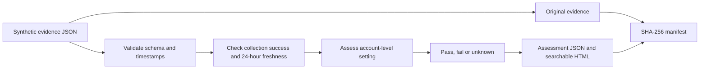

# ControlBridge

ControlBridge is an offline security controls lab. It evaluates whether synthetic evidence explicitly shows that a storage account disallows anonymous blob access. The report keeps evidence quality visible so that missing or stale data cannot quietly become a pass.



## Run the example

Use Python 3.11 or newer. The source checkout runs with the standard library. From the repository root:

```sh
python -m unittest discover -s tests -v
python -m controlbridge --as-of 2026-11-16T12:00:00Z --output outputs/example
```

Use a fresh output directory for each run. Open `outputs/example/report.html` in a browser. Filter by result and select a case to see its reason and original evidence. Add `--gate` to return exit code 1 when a case is fail or unknown. The demo returns **one pass, one fail and three unknowns**.

| Observed condition | Decision |
| --- | --- |
| Fresh, successful collection with explicit false | Pass |
| Fresh, successful collection with explicit true | Fail |
| Missing setting, stale evidence or collection failure | Unknown |

A false setting shows the account disallows anonymous blob access. A true setting permits that access to be configured. Actual exposure depends on container settings. The manifest provides integrity checks for the generated files. Verifying origin would require an independent trust mechanism. This lab runs on fixtures and evaluates one local rule.

[Generated assessment](demo/assessment.json) · [HTML report](demo/report.html) · [Integrity manifest](demo/manifest.json)
